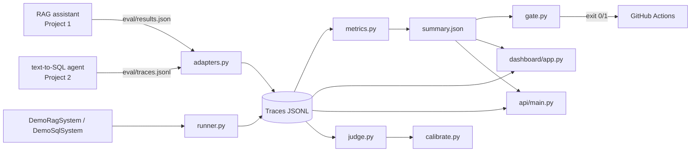

# evalkit — evaluation & monitoring for LLM apps

A small, dependency-light evaluation and monitoring layer for LLM applications.
It gives two portfolio apps — a **manufacturing-docs RAG assistant** and a
**text-to-SQL agent** — a shared trace/eval schema, a metric library, an
LLM-as-judge with an offline fallback, a CI regression gate, a Streamlit
dashboard and a FastAPI service.

Everything here is **runnable with no API keys and no external services**. The
bundled demo systems are deterministic, deliberately imperfect, and driven by a
real in-memory SQLite database for the SQL side.

```
GenAI app  ──emit──▶  Trace (JSONL)  ──▶  metrics  ──▶  summary.json  ──▶  gate ──▶ CI exit code
                          │                                   │
                          └──────────────▶ dashboard / API  ◀─┘
```

---

## Contents

| Path | What it is |
|---|---|
| `evalkit/schema.py` | `Trace` + `GoldenCase` pydantic v2 models, validated JSONL I/O |
| `evalkit/metrics.py` | retrieval, grounding, operational metrics (+ aggregation) |
| `evalkit/judge.py` | rubric LLM-as-judge: OpenAI-compatible **and** offline heuristic |
| `evalkit/calibrate.py` | judge-vs-human agreement, Cohen's kappa, confusion matrix |
| `evalkit/gate.py` | regression gate CLI (`evalgate` / `python -m evalkit.gate`) |
| `evalkit/runner.py` | eval runner + `DemoRagSystem` / `DemoSqlSystem` |
| `evalkit/adapters.py` | ingest sibling apps' emits; optional Langfuse payload mapping |
| `api/main.py` | FastAPI: `/runs`, `/runs/{id}/summary`, `/traces`, `/ingest`, `/health` |
| `dashboard/app.py` | Streamlit dashboard (6 pages) |
| `samples/` | golden fixtures, calibration labels, gate fixtures (all committed) |
| `gate.yaml` | per-metric thresholds with direction |
| `.github/workflows/ci.yml` | pytest + passing gate + a step asserting the gate fails |

---

## Architecture



Each interaction is one `Trace`. A benchmark item is one `GoldenCase`. Runs
write three artifacts into a run directory: `traces.jsonl` (validated traces),
`metrics.json` (per-trace metric rows) and `summary.json` (aggregated metrics).

---

## Install & run

```bash
pip install -r requirements.txt
pip install -e .                     # provides the `evalgate` console script

make test                            # pytest
python -m evalkit run --out artifacts/demo_run --run-id demo-2026-01 --with-judge
python -m evalkit.calibrate --labels samples/judge_calibration.jsonl --heuristic
python -m evalkit.gate --baseline samples/baseline.json --current samples/current.json --config gate.yaml
```

### Dashboard

```bash
streamlit run dashboard/app.py
```

### API

```bash
uvicorn api.main:app --port 8077 --reload
# GET /health | GET /runs | GET /runs/{run_id}/summary | GET /traces | POST /ingest
```

---

## Wiring your app into evalkit (3 lines)

```python
from evalkit.schema import Trace, write_jsonl

trace = Trace(trace_id=str(uuid4()), app="rag", run_id=RUN_ID, question=q, answer=a,
              contexts=[c["doc_id"] for c in retrieved], citations=cited, latency_ms=dt,
              tokens_in=tin, tokens_out=tout, cost_usd=cost, model=MODEL)
write_jsonl("eval/traces.jsonl", [trace])        # append your run's traces here
```

Already emit a looser `eval/results.json`? The adapter maps common field aliases
(`query`/`response`/`passages`/`cited_ids`/`prompt_tokens`/`latency`, …):

```python
from evalkit.adapters import load_or_demo
traces = load_or_demo("D:/projects/ai-ml-portfolio/manufacturing-rag-assistant")
```

`load_or_demo` tries the repo, then falls back to the bundled demo artifacts, so
the dashboard always has data. `evalkit.adapters.to_langfuse_payload` maps a
`Trace` to a Langfuse trace-create payload; `push_to_langfuse` is a no-op unless
the `langfuse` SDK and `LANGFUSE_*` keys are present (no server required here).

---

## Metric definitions

`rel` = set of gold doc ids, `ret` = ranked retrieved ids, `k` = cutoff.

| Metric | Formula | Direction | Meaning |
|---|---|---|---|
| `recall@k` | `|ret[:k] ∩ rel| / |rel|` | higher | share of gold docs retrieved in the top-k |
| `precision@k` | `|ret[:k] ∩ rel| / k` | higher | share of the top-k that are relevant |
| `hit_rate@k` | `1` if `ret[:k] ∩ rel ≠ ∅` | higher | at least one relevant doc retrieved |
| `mrr` | `1 / rank(first relevant)` | higher | where the first correct doc lands |
| `ndcg@k` | `DCG@k / IDCG@k`, `DCG = Σ (2^g − 1)/log₂(i+1)` | higher | rank-weighted retrieval quality |
| `key_fact_containment` | `|{p ∈ must_contain : p ⊆ answer}| / |must_contain|` | higher | required answer phrases present |
| `citation_precision` | `|citations ∩ rel| / |citations|` | higher | cited docs that are actually gold |
| `citation_recall` | `|citations ∩ rel| / |rel|` | higher | gold docs that were cited |
| `refusal_accuracy` | `mean(predicted_refusal == gold_refusal)` | higher | correct refuse/answer decision |
| `refusal_rate` | `mean(refused)` | context | how often the system declines |
| `schema_validity_rate` | `mean(struct_valid)` | higher | structured output parsed/executed |
| `valid_sql_rate` | `mean(sql executes)` (SQL rows) | higher | generated SQL ran without error |
| `sql_repair_rate` | `repaired / (repaired + still errored)` | higher | first-attempt failures recovered |
| `sql_execution_match` | `1` if result multiset == gold multiset | higher | text-to-SQL correctness |
| `task_success_rate` | `mean(task_success)` | higher | end-to-end success per trace |
| `latency_p50/p95/p99` | numpy percentile of `latency_ms` | lower | — |
| `cost_total_usd` | `Σ cost_usd` | lower | run spend |
| `token_efficiency` | `Σ tokens_out / Σ tokens_in × 1000` | higher | output tokens per 1k input |

Retrieval metrics average only over cases with gold docs; `sql_execution_match`
only over SQL rows; `key_fact_containment` only over cases that declare facts —
so a mixed RAG/SQL run still reports meaningful numbers.

---

## Judge & calibration

Two interchangeable backends behind `get_judge()`:

* **`OpenAIJudge`** — used automatically when `OPENAI_API_KEY` is set. Any
  OpenAI-compatible endpoint works (`OPENAI_BASE_URL`, `EVALKIT_JUDGE_MODEL`).
  Falls back to the heuristic on any network/parse error rather than crashing.
* **`HeuristicJudge`** — deterministic, offline. Faithfulness = fraction of
  answer claims supported by the retrieved contexts (token overlap + citation
  support); relevance = question/answer term overlap; correctness = key-fact
  containment blended with faithfulness.

Calibration compares the judge to the bundled 40-item **synthetic/demo**
human-labelled set:

```bash
python -m evalkit.calibrate --labels samples/judge_calibration.jsonl --heuristic
```

Real output on this repo (heuristic judge, threshold 0.5):

```
labelled items     : 40
observed agreement : 0.7750 (77.5%)
Cohen's kappa      : 0.5500
precision (accept) : 0.7200
recall (accept)    : 0.9000
F1                 : 0.8000

            judge=1  judge=0
human=1         18        2
human=0          7       13
```

Kappa ≈ 0.55 is "moderate" — exactly what you expect from a cheap offline
heuristic. It is a **smoke test**, not a substitute for human labels (see
Limitations).

---

## Demo run — real numbers

`python -m evalkit run --out artifacts/demo_run --run-id demo-2026-01 --with-judge`
produced 200 traces (100 RAG + 100 SQL) with the committed artifacts. Actual
aggregated output:

| Metric | Combined (200) | RAG (100) | SQL (100) |
|---|---:|---:|---:|
| recall@5 | 0.700 | 0.700 | n/a |
| recall@10 | 0.700 | 0.700 | n/a |
| mrr | 0.592 | 0.592 | n/a |
| ndcg@5 | 0.546 | 0.546 | n/a |
| key-fact containment | 0.933 | 0.933 | n/a |
| citation precision | 0.950 | 0.950 | n/a |
| citation recall | 0.950 | 0.950 | n/a |
| refusal accuracy | 0.950 | 0.980 | 0.920 |
| refusal rate | 0.100 | 0.120 | 0.080 |
| valid SQL rate | 0.920 | n/a | 0.920 |
| SQL execution match | 0.840 | n/a | 0.840 |
| SQL repair rate | 0.333 | n/a | 0.333 |
| task success rate | 0.890 | 0.940 | 0.840 |
| error rate | 0.040 | 0.000 | 0.080 |
| latency p50 / p95 / p99 (ms) | 340 / 460 / 520 | 330 / 468 / 504 | 355 / 460 / 521 |
| cost total (USD) | 0.1348 | 0.0642 | 0.0706 |
| token efficiency | 60.7 | 81.1 | 43.9 |
| judge mean overall | 0.446 | 0.724 | 0.168 |

The demo RAG system is deliberately imperfect (`recall@5 = 0.70`, 2 wrong
refusals, occasional wrong citation); the demo SQL agent produces ~16% wrong
results and ~8% errors, repairing a third of first-attempt failures. The SQL
judge mean is low because SQL traces carry no retrieved contexts — the judge is
a grounding score, not a SQL-correctness score (use `sql_execution_match` there).

---

## Regression gate

`gate.yaml` sets a direction, an absolute floor/ceiling and a tolerable change
for each metric. The CLI prints a markdown diff table and exits **1** on any
regression.

```bash
python -m evalkit.gate --baseline samples/baseline.json --current samples/current.json --config gate.yaml
# -> 8/8 metrics passed -- no regressions.  (exit 0)

python -m evalkit.gate --baseline samples/baseline.json --current samples/regressed.json --config gate.yaml
# -> 4/8 metrics passed -- 4 regression(s) detected.  (exit 1)
```

Sample failure report:

| metric | baseline | current | delta | status | note |
|---|---:|---:|---:|:--:|---|
| recall@5 | 0.7000 | 0.4000 | -0.3000 | FAIL | below absolute min 0.6 |
| sql_execution_match | 0.8400 | 0.6600 | -0.1800 | FAIL | dropped 0.1800 (> 0.05) |
| task_success_rate | 0.8900 | 0.7950 | -0.0950 | FAIL | dropped 0.0950 (> 0.04) |
| error_rate | 0.0400 | 0.1100 | +0.0700 | FAIL | above absolute max 0.1 |

The gate also guards a **zero baseline** (skips the relative check and flags it)
and reports **missing metrics** according to `on_missing: fail | warn | ignore`.

---

## Dashboard

`streamlit run dashboard/app.py` — six pages, dark-friendly theme, no emojis:

1. **Overview** — KPI cards, quality table, latency histogram, run identity
2. **Retrieval quality** — recall/precision/nDCG/hit-rate per run, MRR chart
3. **Agent quality** — task success, valid-SQL, repair rate, execution match
4. **Traces explorer** — filter by app / errors / latency, expandable Q&A, SQL,
   retrieved contexts and a citation view that flags cited-but-not-gold docs
5. **Regression compare** — two runs side by side, delta table, gate badges
6. **Judge calibration** — agreement, kappa, confusion matrix, per-item verdicts

**Screenshots.** Not committed (they go stale). Reproduce any page by running
`python -m evalkit run …` then `streamlit run dashboard/app.py`; the dashboard
reads `artifacts/demo_run` by default.

---

## CI

`.github/workflows/ci.yml` runs `python -m pytest -q`, then the passing gate,
then a step that **asserts the gate exits non-zero** on `samples/regressed.json`,
then a full demo run.

---

## Limitations

* **The heuristic judge is a smoke test, not a substitute for human labels.** It
  scores lexical grounding/overlap and cannot detect subtle factual errors,
  numeric mistakes or fluent hallucinations. Use the OpenAI-compatible backend
  (or real annotations) for anything that gates a release.
* The bundled calibration labels and demo traces are **synthetic**, produced by
  `samples/make_calibration.py` / the demo systems. Numbers here demonstrate the
  pipeline, not model quality.
* Retrieval metrics assume gold doc ids are known; on real corpora you need
  graded relevance judgements for nDCG to be meaningful.
* Cost is computed from token counts and a fixed per-token constant in the demo
  systems — plug in your provider's real pricing in production.
* Langfuse integration is a payload mapping only; no server is bundled.

---

## License

MIT © 2026 Ratul S Raj — see [LICENSE](LICENSE).
